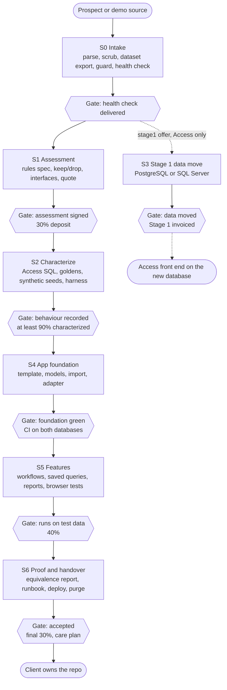
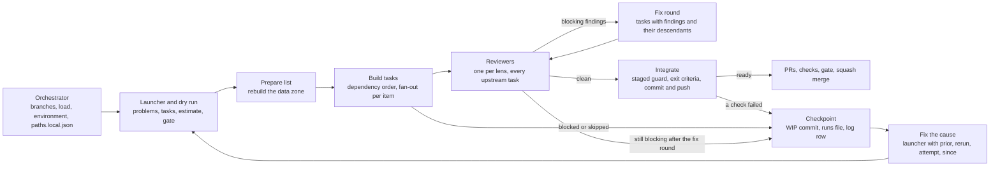
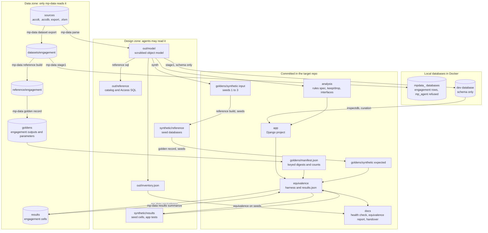

# Modernization pipeline: build plan (demo first, then clients)

**Status:** v2, reviewed 2026-10-16. Nothing has been built or run yet.
**Source:** [`business-plan.md`](business-plan.md), mainly §3 (target stack), §4 (delivery pipeline), §6 (trust), §11 (public demo) and "Next steps".

| File in this folder | In the pipeline repo | What it is |
|---|---|---|
| `proposal.md` | `docs/proposal.md` | This plan: decisions and the reasons for them |
| [`pipeline.json`](../pipeline.json) | `pipeline.json` | Stages, tasks, environment list, agent rules and the pinned stack. The machine-readable truth; the workflow consumes it |
| [`contracts.md`](contracts.md) | `docs/contracts.md` | Every file format, CLI contract, placeholder, path, command form and database rule that tasks must agree on |
| [`runbook.md`](runbook.md) | `docs/runbook.md` | The orchestrator's procedure: setup, per engagement, per stage, logging, gates, change orders, publishing, purge, troubleshooting |
| [`run-stage.workflow.js`](../.claude/workflows/run-stage.js) | `.claude/workflows/run-stage.js` | Generic Workflow-tool driver that runs one stage for one engagement. Tested with mocked agents; only a dry run has gone through the real Workflow tool |
| `make-launcher.py` | `.claude/workflows/make-launcher.py` | Standard-library Python that writes the per-stage launcher `$HOME/engagements/<id>/launch-<S>.workflow.js`. The launcher embeds `pipeline.json` (sliced), `engagement.json`, `gates.json` and, with `--prior`, the prior results, and calls the driver (§10.2). Checked here: for both demos and all seven stages the sliced dry run equals the full-manifest dry run, and the real Workflow tool ran a northwind-demo S2 dry-run launcher |
| [`tests/run-stage.test.mjs`](../tests/driver/run-stage.test.mjs) | `tests/driver/run-stage.test.mjs` | Node test harness for the driver: dry runs of every stage for both demos and a filled client template, failure scenarios, and the agent-estimate table. `node tests/run-stage.test.mjs` exits 0 |
| [`engagements/`](../engagements/) | `engagements/` | `northwind-demo`, `invoicegen-demo`, and `_template` for clients. Client records live outside the repo (§1) |
| the business plan | `docs/business-plan.md` | A copy of the viability plan; never edited |

Where this proposal and `pipeline.json`, `contracts.md` or `runbook.md` disagree, those files win.

**What changed in v2**
- **Environment list and preflight.** One `environment` list in `pipeline.json` (16 items; every fix works in user space without sudo; `docker`, `gh`, `bwrap` and `workflow_size` only check and stop, and the optional `libreoffice` only checks) replaces per-stage preflight lists and the old §10.3 assumptions. The orchestrator runs it before every stage.
- **contracts.md and runbook.md.** Formats, CLIs and command forms moved to `contracts.md`; the orchestrator's step-by-step procedure moved to `runbook.md`.
- **Per-command acceptance proof.** The driver turns every command into an exact string for one agent slot. An agent must report each one verbatim with its exit code; a missing, reworded or failed command makes the task blocked.
- **Transitive reviews and ordered fix rounds.** Each reviewer sees every task upstream of it. A fix round redoes the tasks with findings plus everything downstream of them, in dependency order.
- **Checkpoints and cross-session resume.** A not-ready run commits finished work as a WIP checkpoint and writes `runs/<stage>.json`. The same or a new session continues from it with `prior` (embedded in the stage's launcher), `rerun`, `attempt` and `since`.
- **Data plane.** The private directory has a design zone and a data zone. `mp-data` is the only reader of the data zone and runs its tools in a bubblewrap jail; `mp-run` runs every other agent command with the data zone hidden (from S1 on, and in every client S0).
- **Database roles.** Agents log in as `mp_agent`, which every `mpdata_` database refuses. Engagement rows live only in `mpdata_` databases; mp-data gives agent-written code the `mp_runner` login and only stage1 and purge the superuser.
- **Synthetic zone.** Everything derived only from committed synthetic seeds lives in `private/synthetic/`, so agents debug there with full output.
- **Client template fields.** Opaque client ids, a local records repo, secret references, consent and AI terms, purchased offers and milestones, the Stage 1 cutover, the Windows box and retention.
- **S4 no longer waits for S3.** Stage 1 is its own offer; S4 needs only S2.
- **Exact pins.** Every package, Docker image digest, jar hash, the JDK, jq and Chart.js are pinned. Playwright moves to 1.58.0; Python 3.13.16 comes from uv.

## Summary
- **What gets built:** the delivery pipeline from §4 of the business plan, as a repeatable workflow. The public demo is the pipeline's first two engagements. They run in *bootstrap mode*, which builds the tools along the way. Every later client runs the same stages in *delivery mode* and reuses those tools.
- **Repos:**
  - `modernization-pipeline` (private): tools, templates, the workflow and the demo records.
  - `access-excel-to-django`: the demo deliverables, made public after a legal check.
  - One repo per client, in the client's own GitHub org, and one local records repo per client.
- **Seven stages that follow the sale:** health check, assessment, characterization, Stage 1 data move, app foundation, features, then proof and handover. Each ends at a human gate that matches a deliverable or payment milestone. An orchestrating Claude Code session runs each stage as one Workflow run, following `runbook.md`.
- **Buy before build:** about 30 existing tools cover most of the work, for example UCanAccess and Jackcess to run Access queries on Linux, cookiecutter-django, `inspectdb`, allauth, WeasyPrint, pytest-regressions, datacompy, copydetect and bubblewrap. What is left to build is mostly glue.
- **Client data:** agents work from a scrubbed design model and synthetic seeds. Only `mp-data` touches client data, and it reports counts and hashes, never values (§9).
- **Stack:**
  - Django 5.2 LTS stays, on Python 3.13 (installed by uv; the container ships 3.14).
  - SQL Server is tested alongside PostgreSQL; both run locally in Docker.
  - Rules, goldens, synthetic data and the equivalence protocol don't depend on Django, so a .NET target can be added if buyers ask for it.
- **Effort (estimate, to be measured):** about 51 agents (101 in the worst case) over 7 stage runs for Northwind, and about 10 hours of your time (6.5 h of gates by the gate estimates, about 3.5 h of PR review), inside the plan's 40-hour budget.

---

## 1. Repository names

| Repo | Name | Owner and visibility | Holds |
|---|---|---|---|
| Pipeline (the product) | **`modernization-pipeline`** | `thomas-sodon`, private | toolkit, harness, templates, `scripts/` (mp-data, mp-run), workflow driver, `pipeline.json`, docs, demo engagement records |
| Demo (the proof) | **`access-excel-to-django`** | `thomas-sodon`, private until the northwind-demo S6 gate, then public | `northwind/` and `invoice-generator/`, each exactly what a client would receive, plus a buyer-facing root README and NOTICE |
| Client apps | `<client-slug>-<app-slug>`, e.g. `acme-orders-app` | the client's GitHub org, private; the client creates it before the first stage that pushes code | one engagement's deliverable. Health-check and assessment engagements use a local target repo instead (`target.mode` `local`) |
| Client records | `$HOME/engagements/<id>/record` | a local git repo on your machine; never pushed, never in the pipeline repo, never in a cloud session | engagement.json, quote, estimate, log, gates, answers, change orders, run reports, locks, destruction record |

- Client ids are opaque: `c<YYYY><NNN>`, for example `c2026001`. The client's name appears only in the records repo.
- Demo records stay in the pipeline repo under `engagements/<id>/`.

**Why `access-excel-to-django` for the demo**
- It names the before and the after in the words buyers and their IT providers use. Owners say "our Access database" and "the spreadsheet", not "VBA".
- It covers both demo inputs: Northwind (Access) and InvoiceGenerator (Excel).
- "django" signals standard, non-proprietary output, which is the no-lock-in promise.
- It doesn't depend on a business name that doesn't exist yet, and doesn't lead with a Microsoft sample's name.

**Rejected:**
- `northwind-django`: wrong once phase 2 lands, and it leads with a Microsoft name.
- `access-to-django`: drops Excel.
- `legacy-modernization-demo`: buyers don't search for "legacy".
- A brand name: there is no LLC name yet.

**Why `modernization-pipeline`:**
- It is the §4 "delivery pipeline (becomes the product)".
- It is internal and private, so a plain name beats a clever one.
- Rename it freely once there is a brand.

**Owner:**
- Use the personal account for now, since that is what Upwork proposals link to.
- Move both repos to the LLC's GitHub org when it exists. GitHub keeps redirects after a transfer.
- Neither name exists today in `thomas-sodon` or `Toes-In-The-Sand` (checked).

## 2. What is being built

### 2.1 The pipeline (the product)

"Runs for offers" lists every offer whose `stages` include the stage (top-level `offers`, which the driver gates on). A stage's own `offers` field in `pipeline.json` names only the offer it is sold as (S0 `health-check`, S1 `assessment`, S3 `stage1`, the rest `stage2-small` and `stage2-standard`).

| Stage | Produces | Runs for offers | Agents, typical/worst (northwind-demo) | Gate |
|---|---|---|---|---|
| **S0** Intake | scrubbed object model, dataset export, copy guard, inventory, one-page health check; in bootstrap also the workspace and the data plane | health-check, assessment, stage1, stage2-small, stage2-standard | 8/16 | Health check delivered: report sent to the prospect |
| **S1** Assessment | business-rules spec, keep/drop list, target-neutral interfaces, fixed quote | assessment, stage2-small, stage2-standard | 10/19 | Assessment signed: spec and quote; 30% deposit when Stage 2 is sold |
| **S2** Characterize | Access SQL for every query, reference databases, synthetic seeds, goldens, equivalence harness | stage2-small, stage2-standard | 7/14 | Behaviour recorded: at least 90% of kept units characterized, at most 25% empty |
| **S3** Stage 1 (Access only) | relink scan, schema and data in PostgreSQL and SQL Server with verification, runbook and cutover plan | stage1 | 5/10 | Data moved: Access works on the new database; Stage 1 invoiced |
| **S4** Foundation | Django project from the template, legacy models, core app (import, saved-query registry, equivalence adapter, roles) | stage2-small, stage2-standard | 6/12 | Foundation green: CI on both databases |
| **S5** Features | shared domain functions, one app per feature area, rule tests, browser tests, screenshots | stage2-small, stage2-standard | 9/18 | Runs on test data: 40% |
| **S6** Handover | equivalence report, results summary, before pictures, runbook, deploy docs, notices, purge tool | stage2-small, stage2-standard | 6/12 | Accepted: final 30%; care plan starts |

**Offers** (`pipeline.json` `offers`, prices from `pricing_tiers`, business plan §7):
- `health-check`: free, under 1 hour. `assessment`: $1,500–3,000, credited toward the migration.
- `stage1`: $2,000–5,000, Access sources only, and it can be sold alone after S0, priced from the health check's Stage 1 band (`stage1` in the S0 `estimate.json`).
- `stage2-small`: $8,000–15,000, one app with up to about 20 forms and reports. `stage2-standard`: $18,000–35,000.
- `care-plan`: $200–600 a month. It has no stage yet (§12).
- Prerequisites (`stage_prerequisites`): S1 and S3 need S0, S2 needs S1, S4 needs S2, S5 needs S4, S6 needs S5. For clients the driver refuses a stage that no purchased offer includes, a stage whose prerequisite gate (when a purchased offer includes that stage) is not approved in `gates.json`, and S2 before the S1 deposit.

Each stage is one Workflow run for one engagement. The engagement file sets the mode:
- **Bootstrap** (`"bootstrap": true`): each task also gets a *build spec*, so the tool is built in the pipeline repo, with tests, then applied.
- **Delivery** (every client after that): the tools exist. If one can't handle a client's app, the agent extends it in the pipeline repo, with tests, instead of patching around it in the client's app. This makes the business plan's "reuse is how margins grow" (§3) mechanical: each engagement leaves the tools a little more capable. Client data is only ever read by a reviewed toolkit release that you pin, so an extension that must touch client data waits for a new pin (a manual step).

### 2.2 The demo (the first two engagements)

**`northwind-demo`:**
- Access, bootstrap mode, all seven stages.
- Must keep (engagement `scope.must_keep`): order entry → invoice (printable PDF) → shipping; inventory levels and restocking; purchase order → receiving → stock update; the invoice report plus at most 4 other reports chosen at S1. Sign-in and roles belong to the foundation (S4).

**`invoicegen-demo`** (phase 2):
- Excel, bootstrap mode for the Excel-specific pieces.
- Stages S0–S2 and S4–S6. S3 does not apply to a workbook; S4 builds its development schema from `analysis/data-model.json`.
- Must keep (engagement `scope.must_keep`): customer master (add, view, search); invoice list with status and date paid; PDF, Excel and `.eml` draft (PDF attached) for an open invoice; dashboard year KPIs and monthly net chart for an as-of date.

**Success criteria**, from §8 and the plan's Verification section, adjusted to what we now know. Each command is copied from `pipeline.json` (shown with its placeholders), except two: the guard's `--history` form, which the driver adds to demo integrate and checkpoint checks, and the budget check in runbook section 3. Exit criteria are run by the stage's integrate agent in the command forms of contracts §1 (through mp-run, as a data-plane call, or in an S0 bootstrap run the braced form); a stage is ready only when every one passed.

Both demos:

| Criterion | Command | Where it runs |
|---|---|---|
| S0 reproduces the measured inventory exactly (§3) | `uv run toolkit inventory {{p.records}}/engagement.json --model {{p.private}}/out/model --out {{p.private}}/out/inventory.json --expect` | S0 exit criterion; again in every later stage's prepare list |
| At least 90% of kept units characterized on the engagement data, at most 25% empty | `uv run toolkit golden status {{p.target}}/goldens --rules {{p.target}}/analysis/rules.json --dataset engagement --min-ok 0.9 --max-empty 0.25` | S2 exit criterion, through mp-run (reads committed files only) |
| The reference engine reproduces its own goldens in every cell | `mp-data equivalence {{p.records}}/engagement.json --adapter reference --datasets all --min-pass-per-cell 1.0 --junit-dir {{p.private}}/results/S2` | S2 exit criterion, data-plane call on this machine |
| At least 0.90 in every dataset × database cell: the engagement data and seeds 1–3, on PostgreSQL and SQL Server (8 cells) | `mp-data equivalence {{p.records}}/engagement.json --adapter django --datasets all --dbs from-engagement --min-pass-per-cell 0.9` | S5 and S6 exit criteria (S5 adds `--junit-dir` and `--matrix`); data-plane call against the local Docker databases `mp-pg16` and `mp-mssql22`, as `mp_runner` |
| Rule tests and end-to-end tests pass 100%, and every kept rule has its test | `cd {{p.target}}/app && uv run pytest -q --create-db`, and a second run with `DATABASE_URL="$MSSQL_URL/{{e.db_name}}"` when the engagement uses SQL Server; S5 adds two `test -z "$(jq ...)"` checks that every kept rule with `test_kind` `rule` or `e2e` has a test naming its id | S4, S5 and S6 exit criteria through mp-run, on synthetic data (the SQL Server run is in the S4 and S5 exit criteria and in S6.report's acceptance); target CI repeats them on both databases |
| The equivalence report matches the results | `uv run toolkit report {{p.records}}/engagement.json --results {{p.target}}/equivalence/results.json --out {{p.target}}/docs/equivalence-report.md --check` | S6 exit criterion, through mp-run |
| Nothing from the source is in git | `mp-data guard {{p.records}}/engagement.json --repo {{p.pipeline}} --repo {{p.target_repo}}`, and the same with `--history` | every exit list; `--history` in every demo integrate and checkpoint and in the pre-flip checks (runbook section 6). A legal check comes before the repo goes public |
| Your time stays within `commercial.budget_hours`: 40 h for Northwind, 20 h for InvoiceGenerator | the budget check over `log.md` in runbook section 3 | you, after every gate; it warns at 75% and stops at 100% |

Per demo:

| Demo | Criterion | Command | Where it runs |
|---|---|---|---|
| northwind-demo | Every table on both databases with equal rows, matching digests and no foreign-key orphans | `mp-data stage1 {{p.records}}/engagement.json --target-db local:mpdata_{{e.db_name}}_stage1 --dialects from-engagement --verify --require-rows` | S3 exit criterion, data-plane call |
| northwind-demo | Order → invoice PDF → ship and purchase order → receive → stock run in a real browser on seed 1 | `rm -rf {{p.target}}/docs/img/after && mkdir -p {{p.target}}/docs/img/after && cd {{p.target}}/app && E2E_SCREENSHOT_DIR={{p.target}}/docs/img/after uv run pytest -q --create-db tests/e2e` | S5.e2e acceptance through mp-run (Playwright 1.58.0, Chromium); the target CI e2e job |
| invoicegen-demo | Recomputed formulas match Excel's cached values in all 335 formula cells (335 of 335), and the field sets of the 3 shipped invoices (PDF and xlsx) and the 2 shipped emails match | `mp-data reference selfcheck {{p.records}}/engagement.json --min-match 1.0` | S2.reference_xlsm acceptance and verify, data-plane call |
| invoicegen-demo | Add customer → create invoice → PDF, xlsx and `.eml` → mark paid → dashboard KPI changes, in a real browser on seed 1 | the same e2e command | S5.e2e acceptance through mp-run; the target CI e2e job |

### 2.3 Changes from the business plan
1. **Two repos instead of one public repo.**
   - The toolkit is what the plan expects to license later (§9, "When to productize"), and publishing it now undercuts that.
   - The public demo publishes the outputs plus the equivalence runner, which is enough for anyone to check the claims.
   - Until you productize, the free health check is a service: the prospect sends a design-only file. It is not a downloadable scanner.
2. **The viability plan is not published** (§11 item 6). Pricing, channels and kill criteria aren't for prospects or competitors. The public README carries a buyer-facing summary instead.
3. **Python 3.13, not 3.12.** The last cookiecutter-django tag on Django 5.2 (2026.03.09) requires Python 3.13. This container ships Python 3.14.4 only, so uv installs 3.13.16 (environment item `python313`).
4. **Goldens come from running the Access SQL on UCanAccess**, not from translating it into SQLite or Postgres (§11 item 3).
   - Northwind's goldens are committed as keyed digests only (HMAC-SHA256 keyed by the data file), because the outputs are Microsoft's data.
   - Synthetic-seed goldens are committed in full.
5. **`extractor/` becomes `toolkit/`.** It now also records goldens, moves data, generates synthetic data, writes the report and runs the data plane.
6. **Corrected numbers** (§3 below). The old branch name in "Next steps" (`claude/sweet-pasteur-dw6ykm`) is not reused.
7. **Two-zone data plane.** The plan's "agents see schema, not data" becomes mechanical. In the private directory the design zone (`out/`, `review/`, `synthetic/`) is what agents may read; the data zone is everything else, and only `mp-data` reads it (§9).
8. **Outside the pipeline:** the website, the case-study page (the demo root README section serves as the case study), the scanner MVP, the referral program, the month-6 review, and the health-check terms, MSA, SOW, DPA and E&O insurance. The pipeline records only `data_policy.client_consent.document`.

## 3. What the real Northwind file showed
I downloaded the template on 2026-10-16 into a scratch folder, listed it and counted it. It was never committed.

| | Business plan | Measured | Consequence |
|---|---|---|---|
| Tables / queries / forms / reports / modules | 28 / 65 / 40 / 15 / 18 | Same; the 18 modules are 17 standard plus 1 class module. 1 standalone macro | Plan holds |
| Data macros | "75 data-macro files" | 75 `.axl` files in all: 20 under `objects/dataMacros/`, one BeforeChange macro each, and 55 under `objects/properties/`, which are object metadata | Only the 20 count (`data_macro_files`, contracts §5). They are validation rules; they become model `clean()` methods or constraints |
| VBA | about 5,800 lines | **6,886 non-blank lines**: 2,280 in modules, 4,606 behind 48 forms and reports | Rule recovery is about 20% bigger, and most logic sits behind forms |
| How queries are stored | assumed SQL | **63 of 65 are query-design grids** (tables, columns, joins, groups, sort), not SQL. 2 are SQL text, 1 of them a UNION | Needs a design-to-SQL step; Jackcess already has one |
| Query features | – | All are selects. Joins in 25, outer joins in 9, grouping in 10. Functions: Format, Space, Nz, DateValue, CDbl, Left. 1 query reads a form control | UCanAccess supports every one of these functions |
| App functions in queries | – | 4 VBA functions: `ProductAllocated`, `ProductOnOrder`, `ProductToSell`, `ProductNoStock` | The reference engine needs them as paraphrased correlated-subquery rewrites (Java only when reusable); Django re-implements them from the spec in `domain/` |
| Encodings | – | Forms, reports, queries and macros are UTF-16LE with a BOM; modules are cp1252; CRLF line ends | The parser detects the encoding per file and accepts CRLF and LF |
| Download | 12.9 MB | 12,895,205 bytes, SHA-256 `5c38b53e…df6e5e2`, HTTP 200 from a cloud container; last-modified 2024-11-27, etag and content-md5 recorded | Pinned in `engagements/northwind-demo/engagement.json`; a HEAD request catches drift before the download |

**InvoiceGenerator** (measured the same day at commit `831e5272…`, MIT, "Copyright (c) 2023 MaxineXiong"; never committed, credited in NOTICE):
- `Invoice_Generator.xlsm`, 344,254 bytes: 7 worksheets, 3 ListObjects, 6 calculated columns, 335 formula cells (277 use structured references), 2 broken defined names.
- VBA: 13 components (1 standard, 0 class, 8 document, 4 userforms), 546 non-blank lines, 24 procedures. The repo's `VBA Code/` export covers the 6 components with logic.
- Sample outputs: 3 PDF, 3 xlsx in Strict Open XML (openpyxl 3.1.5 cannot load them as they are) and 2 Outlook `.msg` emails. No `.eml` ships.
- formualizer 0.11.1 alone returns `#NAME?` for 324 of 335 formula cells, because it does not see the tables. Hence the structured-reference rewrite (§5).

## 4. Stack decision: Django stays, SQL Server joins, .NET waits for demand

**Keep Django 5.2 LTS** (5.2.18; supported to April 2028) as the only app target for now. The template pins 5.2.12 and the overlay upgrades it.
- Almost all of the Django stack already exists as maintained packages; see §5.
- The business plan says a human reviews every change. Your review and accountability are part of what the client buys, and you can give both in Django today.
- Two stacks would double the template upkeep, CI and security patching (WeasyPrint alone shipped three CVE releases this year), and split care-plan support. They wouldn't reduce the biggest risk, which is sales.

**Make SQL Server first-class.** Access shops and their IT providers live in Microsoft 365 and Azure, and Stage 1 already moves data to SQL Server or Azure SQL.
- `mssql-django` 2.0.0 (Microsoft, 2026-09-18) supports Django 5.2–6.1. The app uses the `mssql-python` 1.16.0 driver (`OPTIONS python_driver` `mssql_python`). mssql-django still imports pyodbc, which needs libodbc, and the ODBC Driver 18 that mssql-python bundles needs libltdl; both are unpacked in user space (environment item `syslibs`).
- Both databases run locally in Docker, from pinned image digests: PostgreSQL 16 as `mp-pg16` on 127.0.0.1:55432 and SQL Server 2022 (Developer edition, for development and tests only) as `mp-mssql22` on 127.0.0.1:14330. Only the `postgres` and `mssql` environment items create and provision them.
- Agents connect as `mp_agent` and use only their own databases: `<db_name>_dev` (schema only), `<db_name>` (app development, synthetic data) and `test_<db_name>_<slot>`. Engagement rows live only in databases named `mpdata_…`, which `mp_agent` cannot open (§9).
- Every target repo's CI runs on PostgreSQL 16 and on SQL Server 2022 service containers. The equivalence report's SQL Server cells come from the local runs; CI is a cross-check.
- The app keeps the original table and column names. It can therefore run on the Stage 1 database next to the old Access screens, which is the parallel run the trust section (§6) promises.

**Keep the front half target-neutral.** The object model, rules, goldens, synthetic seeds and the equivalence protocol are JSON, CSV or Markdown. The harness reaches the app through a small adapter. Two things follow:
- A .NET target later means a new template and adapter (ASP.NET Core, with EF Core scaffolding in place of `inspectdb`), not a rebuild.
- The pivot "sell the toolkit to Access consultants" (§8) gets easier, since most of them work in Microsoft stacks.

**Trigger for adding .NET:** about 3 qualified prospects, or one MSP partner, who require it.
- Add a stack-preference question to the first discovery calls.
- Nothing I found measures how often small-business Access owners demand .NET, so the plan uses a trigger instead of a guess.

## 5. Buy versus build
Four research passes (2026-10-16) checked current versions, licences and maintenance against PyPI, Maven Central and the projects' sources. Exact pins are in `pipeline.json` `stack`. ADOPT means use as is; ADAPT means wrap or extend; BUILD means nothing fits.

| Need | Use | Verdict | Still to build |
|---|---|---|---|
| Read `.accdt` and SaveAsText | Python stdlib (`zipfile`, `xml`) | BUILD, small | SaveAsText block parser, XSD and `.axl` readers. *access2flow* already parses Northwind's `.accdt` but has **no licence**, so we can't use its code. Ask its author for MIT or Apache, and switch to ADAPT if granted |
| VBA procedure index | – | BUILD, thin | A procedure scanner. The MIT `vb6` grammar from ANTLR grammars-v4 is the fallback if a full parse is ever needed |
| Excel VBA and workbook structure | oletools 0.60.2 (olevba), openpyxl 3.1.5 | ADOPT | Strict Open XML sample files get their namespaces rewritten to transitional before openpyxl |
| Query designs → SQL | Jackcess 5.1.7 query formatter (Apache-2.0), called through JPype 1.7.1 | ADAPT | Map design blocks to Access's internal query rows (attributes 1, 2 and 5–11; select objectFlag 0, UNION 128) |
| Run Access SQL on Linux | **UCanAccess 5.1.8** (Apache-2.0) with hsqldb 2.7.4: Nz, Format, DateValue, CDbl, Space, Left, IIf; custom-function hook. No extra runtime jars: Jackcess declares POI as optional | ADOPT | A loader for the sample data; the 4 app functions as correlated-subquery rewrites, or Java classes with `@FunctionType` that `start_jvm` compiles with javac at each JVM start (so it needs a JDK: Temurin 21 in user space) |
| Client `.accdb` or `.mdb` on Linux | UCanAccess and Jackcess for tables, data, relationships and query SQL; jetdb CLI for VBA (young) | ADOPT, when the first client needs it | Forms and reports still need Windows with Access (see §9 on intake) |
| Workbook formulas | formualizer 0.11.1 (MIT) after a structured-reference → A1 rewrite; Excel's cached values as the check; LibreOffice headless as an optional cross-check | ADAPT | The rewrite. `reference selfcheck --min-match 1.0` must match 335 of 335 formula cells |
| Workbook macro behaviour | The shipped PDFs (pypdf 6.20.1), workbooks (openpyxl) and `.msg` emails (olefile 0.47, BSD; never extract-msg, GPL); optional Windows + Excel via xlwings | ADOPT | Field extraction into canonical document fields (contracts §16) |
| Stage 1 data move | SQLAlchemy 2.1 Core with psycopg[binary] 3.3.6 and mssql-python 1.16.0. SSMA for Access when a SQL Server client prefers Microsoft's tool | ADOPT | schema.json → SQLAlchemy metadata, verification, relink scan |
| SQL Server driver on Linux | mssql-python 1.16.0, which bundles ODBC Driver 18; libodbc2 and libltdl7 unpacked in user space (no sudo here) | ADOPT | – (environment item `syslibs`) |
| Django models | `inspectdb` on Postgres (tested: keeps FKs, lengths and precision) | ADOPT | Curation |
| Project template | cookiecutter-django tag `2026.03.09` (commit `47fa6ff7…`, the last one on Django 5.2), cookiecutter 2.7.1 | ADAPT | An overlay: HTMX, audit log, reports, SQL Server, area autodiscovery, Microsoft group → role mapping |
| Lists, filters, forms | Django admin, django-tables2, django-filter, crispy-bootstrap5, django-htmx, django-template-partials | ADOPT | The workflow screens |
| Sign-in | django-allauth 65.19.7 (local accounts, Microsoft provider, MFA) | ADOPT | A small Entra-group → role adapter |
| Audit log | django-simple-history 3.13.0 | ADOPT | – |
| PDF and Excel output | WeasyPrint 70.0 (needs libpangoft2, unpacked in user space) with django-weasyprint; django-import-export[xlsx]; openpyxl | ADOPT | Report templates |
| Dashboard chart (invoicegen) | Chart.js 4.5.1 (MIT), vendored from its pinned URL with a THIRD_PARTY.md | ADOPT | – |
| Access functions in outputs (Format, Nz…) | Jackcess's Format code as the behaviour reference | BUILD, small | `vbacompat`, covering only the functions apps actually use |
| Scheduled jobs | cron or systemd timers running management commands | ADOPT | – |
| Backups | Managed Postgres or Azure point-in-time restore; django-dbbackup for portable dumps | ADOPT | A restore-drill page in the runbook |
| Golden files | pytest-regressions 2.11.0, for committed synthetic seeds only; engagement outputs are compared by keyed digest | ADAPT | Canonical form, keyed-digest manifest; `--force-regen` and `--regen-all` are refused |
| Result diffs, with redaction | datacompy 1.1.0 (`hide_sensitive_columns()`, `report(sample_count=0)`) | ADOPT | The redaction plugin (§9) |
| Synthetic data | Faker 40.43.0 (seeded); factory_boy 3.3.3 for Django test fixtures | ADAPT | A schema-driven generator that fills tables in foreign-key order |
| Forbidden files | pre-commit 4.7.0 `language: fail` hooks, check-added-large-files | ADOPT | – |
| Copy detection | copydetect 0.5.0 with `disable_filtering=True` (its default filter drops comments, strings and prose, which is what the guard must see) | ADOPT | Corpus builder (UTF-8) and the guard command |
| Equivalence report | JUnit XML from the test runs | BUILD, small | A generator and a template |
| Browser tests | pytest-playwright 0.10.0 with playwright 1.58.0, whose chromium-1208 is preinstalled here (1.56.0 refuses to install browsers on Ubuntu 26.04) | ADOPT | – |
| Command isolation for mp-run and mp-data | bubblewrap (0.11.1 here) | ADOPT (system package) | `mp-run` and mp-data's jail (§9) |
| JSON in commands | jq 1.8.1 (static binary, pinned hash) | ADOPT | – |
| Local databases | Docker images `postgres:16.15` and `mcr.microsoft.com/mssql/server:2022-latest`, pinned by digest | ADOPT | The environment items |
| Python, uv and Java in user space | uv 0.13.1, Python 3.13.16 managed by uv, Temurin JDK 21.0.12.1+1 | ADOPT | The environment items |
| Orchestration | Workflow tool | ADOPT | `run-stage.workflow.js` (written and tested with mocked agents) and `make-launcher.py`, which embeds the driver's input files in a per-stage launcher |

**Dropped from my first draft because something already does it:**
- an Access-to-SQLite SQL translator and SQLite function library (UCanAccess);
- a model generator (`inspectdb`);
- a snapshot framework (pytest-regressions);
- a diff tool (datacompy);
- a plagiarism detector (copydetect);
- a template written from scratch (cookiecutter-django).

**Rejected:**
- SDV: Business Source Licence, and it trains on the real data.
- pycel (GPL), formulas (EUPL) and extract-msg (GPL) inside delivered code.
- MOSS: it uploads the text to a third party.
- django-auditlog: its Jazzband home is winding down.
- Celery: overkill here.
- Neapolitan and Falco: still alpha or beta.
- SaaS Pegasus: paid, and can't be published.
- pgloader: no Access support.
- JayDeBeApi: stale; JPype instead. (Not for its LGPL licence: psycopg is LGPL too.)
- Cross-database checkers (Google DVT, data-diff): they need two live databases, and data-diff is archived.
- The Claude Code sandbox for client sessions: it cannot reach the local databases or Docker on Linux (§9).
- A LibreOffice Docker image: LibreOffice stays an optional local cross-check.

**Nothing makes the pipeline redundant:**
- SSMA moves tables and most select queries only.
- GAPVelocity outputs C#/.NET for enterprises.
- FmPro Migrator targets FileMaker, .NET and LiveCode.
- Microsoft has no VBA converter.
- Excel-to-web services drop the macros.
- No tool found produces Django from Access forms, reports and VBA.

## 6. Repository layouts
Owned paths per task are in `pipeline.json` (`owns`, `owns_except`); the prefixes are in contracts §1.

**Pipeline repo (`modernization-pipeline`, private)**
```
docs/business-plan.md            copy of the viability plan (never edited)
docs/proposal.md                 this plan
docs/contracts.md                formats, CLIs, placeholders, command forms, databases
docs/runbook.md                  the orchestrator's procedure
docs/formats/                    model.md, dataset.md, canonical-output.md (prose for contracts §4, §7, §10)
pipeline.json                    stages, tasks, environment list, rules, pinned stack
engagements/<id>/                demo records: engagement.json, log.md, quote.md, estimate.json, answers.md,
                                 gates.json, runs/, change-orders/ (no data); _template/ for clients
CLAUDE.md                        zones, env file and command forms for every session
.claude/settings.json            SessionStart hook only (no sandbox or permission keys)
.claude/hooks/session-start.sh
.claude/workflows/run-stage.js   the stage driver
.claude/workflows/make-launcher.py writes the per-stage launcher that embeds the driver's input files
.github/workflows/ci.yml         lint, unit tests (mp-run tests included), guard --hooks-only, the driver test
scripts/                         mp-data, mp-run, mp-bash-hook, install-mp-data.sh, client-settings.sh, dev_db.sh
toolkit/                         Python 3.13 package, `toolkit <command>`; one commands/<name>.py per subcommand
  cli.py engagement.py quiet.py secrets.py dataplane.py fetch.py
  sources/ saveastext.py schema.py vba.py datamacros.py model.py scrub.py dataset.py guard.py
  inventory.py healthcheck.py estimate.py(+.toml) rules.py
  reference/                     JPype bridge, design→SQL via Jackcess, UCanAccess runner
  reference_xlsm/                structured-reference rewrite, formualizer recompute, document fields
  synth.py golden.py equivalence.py typemap.py relink.py stage1.py
  report.py results.py purge.py wireframe.py wireframe_xlsm.py
  schemas/                       engagement, summary, model, dataset, rules, data-model
  tests/, tests/fixtures/<name>/ synthetic fixtures only (parse, dataset, guard, inventory, rules, reference,
                                 synth, golden, relink, stage1, new_app, report, wireframe, ...)
harness/                         target-neutral equivalence runner, vendored into every target:
                                 plugin, adapter, compare, redact, canonical, dataset
templates/django-overlay/        applied on top of cookiecutter-django 2026.03.09 (core/ belongs to S4.data)
templates/feature-app/           skeleton for one S5 area
templates/e2e/                   e2e conftest and README
templates/docs/                  health check; assessment/ (rules.md, quote.md, change-order.md);
                                 stage1 runbook and cutover; equivalence report; handover/
java/                            reusable UCanAccess app functions (compiled with javac at each JVM start)
tests/driver/run-stage.test.mjs  driver tests with mocked agents
vendor/ (gitignored)             the three pinned jars; fetch restores them
```

**Target root.** This is a client's repo, or `northwind/` or `invoice-generator/` inside the demo repo.
```
app/            Django project (cookiecutter-django + overlay): config/; <slug>/legacy/ (models);
                <slug>/core/ (import, saved-query registry, equivalence adapter, roles; core/local/ for this
                engagement); <slug>/domain/ (shared functions); <slug>/<area>/ (one app per kept area); tests/e2e/
analysis/       rules.md, rules.json (signed: null; the signature lives in gates.json), keep-drop.md,
                interfaces.md, data-model.json (xlsm), rules/<area>.*
goldens/        manifest.json (keyed digests, counts, columns; never values), params.json (definitions and
                synthetic values only), reference/functions/ (paraphrased app-function rewrites),
                synthetic/seed-N/{input,expected}
equivalence/    vendored harness, adapter.toml, results.json (counts only), so the client can re-run the proof
docs/           health-check.md; stage1-frontend-changes, stage1-report, stage1-runbook, stage1-cutover (Access);
                staging.md, equivalence-report.md, known-differences.json, runbook.md, data-policy.md, data-retention.md,
                access-and-ownership.md, walkthrough.md and legal-check.md (required for demos), deploy/,
                img/before/, img/after/
README.md, NOTICE.md
```
The target repo root also holds `.pre-commit-config.yaml`, `.gitignore`, `.gitattributes`, `.github/workflows/guard.yml` and `.github/workflows/<slug>.yml` (lint, tests on both databases, harness on seeds 1–3, e2e on seed 1; no toolkit, no secrets).

**Demo repo root.** `README.md` (buyer-facing) and `NOTICE.md` keep one section per engagement between the marker lines `<!-- engagement:<id> -->` and `<!-- /engagement:<id> -->`. Setup creates both files; each engagement's S6.handover fills only its own section. `LICENSE` is MIT for our code, subject to the legal check.

**Private engagement directory** (`$HOME/engagements/<id>/private`, never in git; same path in every stage and session):

| Zone | Paths | Who reads it |
|---|---|---|
| Design | `out/` (scrubbed model, inventory, reference catalog and SQL), `review/<slot>/` (reviewer scratch), `synthetic/` (seed reference databases, synthetic JUnit and matrices, pytest-regressions files, e2e screenshots and video) | agents, with full output |
| Data | `sources/`, `datasets/`, `workbook/`, `reference/`, `goldens/`, `corpus/`, `results/`, `logs/`, `assets/`, `scrub-map.json` | only `mp-data` |

Reference databases follow the zones: `uv run toolkit reference build <eng> --dataset seeds` writes `synthetic/reference/seed-N.accdb` (xlsm `.xlsx`), and `mp-data reference build <eng> --dataset engagement` writes `reference/engagement.accdb`. `--dataset all` exits 2. Each stage's `prepare` list rebuilds the private directory when it is lost.

**Engagement directory and records.** `$HOME/engagements/<id>/` also holds `run.env` (the runbook's shell variables), generated preflight scripts and PR bodies. Clients add `record/` (the records repo: its own local git repo, never pushed; opaque ids such as `c2026001`, §1), `pipeline/` (a pipeline worktree), `target/` (the target clone) and `client-session.json`. Demo records live in the pipeline repo (`engagements/<id>/`).

## 7. Stages in detail
Task-level detail lives in `pipeline.json`: goal, owned paths, inputs (contracts anchors), tools to reuse, stack keys, the bootstrap build spec, deliverables, acceptance and verify commands, and effort. Each stage run goes: the orchestrator's `prepare` list → build tasks in dependency order → reviewers, two lenses per stage → at most one fix round (`max_fix_rounds` 1) → integrate, or a checkpoint when not ready.

| Stage (agent budget) | Tasks (→ = depends on) | What they build | Gate minutes |
|---|---|---|---|
| S0 Intake (8) | S0.workspace → S0.parse → S0.dataset → S0.guard; S0.parse → S0.healthcheck; S0.review after guard and healthcheck | workspace: uv project, engagement loader, quiet output, mp-data and its jail, mp-run, mp-bash-hook, client-settings.sh, dev_db.sh, hooks, CI, source fetch; parse: scrubbed object model; dataset: engagement dataset export; guard: copy guard and corpus; healthcheck: inventory, estimate, health check | 25 |
| S1 Assessment (10) | S1.tooling (bootstrap only) → S1.areas (fan-out, at most 4 areas; a scout picks them on the first run) → S1.synthesize → S1.review. S1.change_order runs instead in a change-order run | rules and data-model schemas and the checks later stages use (rules-lint, rules-coverage, rules-render, spec-check, schema-lint); rules per area; rules.md, rules.json, keep-drop, interfaces, data-model (xlsm), estimate, quote, answers.md skeleton | 90 |
| S2 Characterize (7) | S2.reference (Access kinds) or S2.reference_xlsm (xlsm), and S2.synth → S2.golden → S2.harness → S2.review (lenses by source kind) | design → Access SQL and the UCanAccess runner with app-function rewrites, or the workbook recompute and document fields; synthetic seeds 1–3; canonical output and goldens; the target-neutral harness, vendored into the target | 40 |
| S3 Stage 1 (5; Access kinds only) | S3.relink_scan → S3.move → S3.review | relink scan and type map; schema and data in PostgreSQL and SQL Server with verification; stage1 report, runbook and cutover plan | 30 |
| S4 Foundation (6) | S4.template → S4.models → S4.data → S4.review | Django project from the pinned template and the overlay, target CI; legacy models from a schema-only dev database; core app: dataset import, saved-query registry, equivalence adapter, vbacompat, roles | 40 |
| S5 Features (9) | S5.shared → S5.features (fan-out, at most 4 kept areas from rules.json) → S5.e2e → S5.review | shared domain functions and the feature-app skeleton; one Django app per kept area with its rule tests, view tests and scheduled jobs as management commands; browser tests, screenshots, the walkthrough video and the staging notes (`docs/staging.md`) | 60 |
| S6 Handover (6) | S6.report; S6.visuals (accdt, vcs-export) or S6.visuals_xlsm (xlsm), both skipped when `assets.screenshots` is set; S6.report → S6.handover; S6.audit after handover and visuals | full equivalence matrix, results.json, report, purge; before pictures; README, NOTICE, runbook (with the go-live and smoke checklist and the scheduled jobs), deploy, data policy, access and ownership, retention, legal check | 105 |

**Agents per stage run**, typical/worst, as printed by the driver test against these files (S1 with the scout, S5 with items from `areas_hint`; the client column is a filled copy of `_template`):

| Stage | Budget | northwind-demo | invoicegen-demo | client |
|---|---|---|---|---|
| S0 | 8 | 8/16 | 8/16 | 8/16 |
| S1 | 10 | 10/19 | 10/19 | 9/17 |
| S2 | 7 | 7/14 | 7/14 | 7/14 |
| S3 | 5 | 5/10 | n/a | 5/10 |
| S4 | 6 | 6/12 | 6/12 | 6/12 |
| S5 | 9 | 9/18 | 9/18 | 7/14 |
| S6 | 6 | 6/12 | 6/12 | 6/12 |
| total | | 51/101 | 46/91 | 48/95 |

- Typical: one agent per build task and fan-out item, a scout when no items are passed, one per review lens, plus integrate. Worst: every task, item and lens needs the fix round, plus a checkpoint.
- Every run fits in a workflow of 20 agents. Raise **Dynamic workflow size** in `/config` so one workflow may run at least 20 agents (runbook 0.7; the `workflow_size` environment item checks it), and pass `max_agents` = the dry run's worst case.
- This machine runs 6 agents at a time; larger fan-outs queue.
- More than 4 areas blocks the fan-out unless you pass `allow_over_budget: true`.
- App functions: correlated-subquery rewrites live in the target's `goldens/reference/functions/`; reusable Java lives in `pipeline:java/`, and `start_jvm` compiles it with javac into a temporary jar at each JVM start, so no task owns a compiled jar.

## 8. Rules every agent follows
These are the 27 `constraints` in `pipeline.json`; every prompt includes them. In short:
- **Run commands exactly as given.** Each command comes in one of three forms (contracts §1): `mp-run --eng … --slot … -- '<command>'`, a standalone `mp-data --slot … <command> …`, or, only in an S0 bootstrap run, the braced form. Report each one verbatim with its exit code; a reworded or missing command counts as not run.
- **mp-data calls stand alone.** One simple command, no pipe, `&&`, redirection, substitution or `cd` around it, and never inside mp-run.
- **Never read the data zone.** Read only `out/`, `review/` and `synthetic/` in the private directory. Write synthetic outputs under `synthetic/`. Debug on synthetic seeds with `uv run toolkit …`.
- **Treat demo data as client data.** No rows or values in tracked files, prompts, notes or answers; use counts, column names and hashes. Use scrubbed tokens such as `<SECRET-1>` as they are.
- **Stay out of `mpdata_` databases.** Use your own databases (`<db_name>_dev`, `<db_name>`, `test_<db_name>_<slot>`); never run docker, psql or sqlcmd.
- **No secrets.** Never print, request or read secret values, data.env or environment dumps. Client target pushes and PRs go only through `mp-data push` and `mp-data gh`.
- **No source material in git.** No source files, sample outputs, data values, or verbatim VBA, query or macro text. Paraphrase. Run the guard before reporting done.
- **Owned paths only.** Edit only what your task owns; list anything else in `requests`.
- **Only integrate and checkpoint commit.** Never `git add -A` or `git add .`.
- **Dependencies are declared at S0 (toolkit) and S4 (app).** A missing package means status blocked with `dependency: <spec> for <reason>`; the orchestrator adds it and reruns the task.
- **Tools come from the environment preflight.** No sudo, no pip into the system Python; a missing tool means blocked, naming the environment item.
- **Reviewers run only verify commands** and write under `review/<slot>/`.
- **No gaming.** No skipped tests, loosened tolerances or edited goldens. App code computes from the database and never reads goldens or branches on dataset or seed.
- **Reuse first.** If a listed tool doesn't fit, report blocked with evidence instead of writing a replacement.
- **Clean room for access2flow.** Agents must not open it, because it has no licence.
- **Portability and neutrality.** No PostgreSQL-only features. The front half stays target-neutral.
- **Signed rules are frozen.** After the S1 gate only an approved change order changes `analysis/rules.*`.
- **Human-only steps** go to `manual_steps`; blocked only when acceptance cannot pass without them.

Why these rules matter: the riskiest failures in this project aren't crashes. They are a leaked Microsoft or client file, client data in an agent's context, a test that passes for the wrong reason, and two agents editing the same file. Each rule closes one of those, and the reviewers' lenses check for them.

## 9. Data handling and where each engagement runs

**Threat model.** The measures below stop *accidental* exposure of client data, to the model context, to committed files and to databases agents can read, by agents that follow their prompts. They enforce that with cheap operating-system means: mp-run and mp-data's jail, a Bash hook, deny rules, database roles, quiet tools and the guard. They do not claim to contain a deliberately hostile agent; v2 adds no further hardening, and the residual risks are recorded in §11 (contracts §1).

**Where each engagement runs**
- **Demos:** they run on your machine, which has Docker, bwrap and the private directory the stages need; `data_policy.execution` `cloud-allowed` only records that the data is a public sample. They still rehearse the client rules in the same command forms: data zone, mp-data, redaction, scrub, `mpdata_` databases, and from S1 on every other agent command runs through mp-run. A task that only works by reading the data zone fails in the demo already.
- **Clients:** only on your own approved machine (`execution` `local`, the host marker `$HOME/.config/modernization/client-host`, `host_attested: true`), never in a cloud session.

**mp-data, the data plane.** Every read of the data zone is one standalone call, `mp-data [--slot <slot>] [--if-built] <command> <records>/engagement.json …`. The commands are fetch, parse, dataset, guard, reference, golden, stage1, equivalence, results, purge, push, gh and pin. mp-data:
- prints exactly one JSON summary line: status, counts, hashes, column names and unit ids, never values. A summary that contains a corpus string is withheld.
- writes the full output to `private/logs/` (data zone), one log file per call.
- runs the toolkit from the pipeline worktree for demos. For clients it runs a reviewed release that you pin in a terminal (`mp-data pin <sha>`), which agent commands cannot change.
- runs its toolkit child in a bubblewrap jail. The child can write only this engagement's data zone, a per-call temporary directory and the call's declared outputs. data.env, the pass store, Docker, your session sockets and other engagements are hidden. The host network is kept, so the local databases work.
- resolves the secrets a call needs before the jail starts and hands each one to the child only as an `MP_SECRET_<FIELD>` environment variable, never in arguments, logs or files.

**mp-run, for every other agent command** (from S1 on, and in every client S0; an S0 bootstrap run uses the braced form because it builds mp-run). `mp-run --eng <records>/engagement.json --slot <slot> -- '<command>'` runs one command under bubblewrap. The data-zone directories read empty; scrub-map.json and data.env cannot be read; the Docker sockets, the pass store, other engagements and `$XDG_RUNTIME_DIR` are hidden. The installed tools, the Claude Code settings and the repos' git hooks and config are read-only. The host network is kept. git and gh inside it use gh's file-stored token, because the keyring is hidden.

**Why not the Claude Code sandbox for clients.** The sandboxing docs ([code.claude.com/docs/en/sandboxing](https://code.claude.com/docs/en/sandboxing)) say that on Linux a sandboxed command's `localhost` is private to it, so it cannot reach servers on the host's 127.0.0.1, and that `docker` is incompatible with the sandbox. Every S3–S6 database test would fail. Engagement rows also sit in local databases, which a filesystem deny rule never protected. So client sessions run with the sandbox off and get instead:
- **Generated settings per engagement:** `scripts/client-settings.sh <id>` prints the settings, the runbook writes them to `$HOME/engagements/<id>/client-session.json` from main before every session start (runbook 1.10), and the session starts with `claude --settings` on it (contracts §17). Read, Edit and Write are denied on this engagement's data zone, every other engagement's private and record directories, and data.env. Edit and Write are also denied on the installed tools, the Claude Code settings, the repos' git hooks and config, and the settings file. Read is denied on `/proc`. Bypass-permissions mode is disabled.
- **A Bash hook** (`mp-bash-hook`, PreToolUse) that allows a Bash call only when it is exactly one `mp-run` or `mp-data` call. It covers workflow agents too. The settings allow `Bash(mp-run:*)` and `Bash(mp-data:*)`, so agents' many such calls don't each wait for approval; the hook still checks every call first.
- **The database roles** below.
- The environment preflight and every gate step that touches Docker, data.env, the data zone or an `mpdata_` database run in a plain terminal outside Claude. There, git on client repos runs as `rgit`, with repo hooks and fsmonitor off.

**Database roles.** Three per server (contracts §1):

| Role | Used by | Reaches | URL kept in |
|---|---|---|---|
| `mp_agent` (LOGIN CREATEDB; SQL Server: CREATE ANY DATABASE) | agents, their tests, the app in development | its own databases; refused by every `mpdata_` database | the env file (`PG_URL`, `MSSQL_URL`) |
| `mp_runner` (same rights) | data-plane commands that run agent-written code: equivalence, reference build, run and selfcheck, golden record; the app at the S5 client gate rehearsal | PostgreSQL: only `mpdata_` databases and the `postgres` maintenance database (`pg_hba.conf`); SQL Server: the databases it creates or is given (`mpdata_test_…`, `mpdata_<db_name>_gate`) | data.env only |
| superuser (`postgres`, `sa`) | toolkit-only data-plane commands (stage1, purge), the environment items, you | everything | data.env only |

- On the local servers, engagement rows enter only databases named `mpdata_<db_name>_stage1` (Stage 1 load), `mpdata_<db_name>_gate` (S5 client gate import) and `mpdata_test_<db_name>_<slot>` (Django tests of data-plane runs). mp-data refuses a local database without the prefix, and an `mpdata_` database owned by anyone but the superuser or `mp_runner`.
- PostgreSQL: the `postgres` item keeps these lines at the top of `pg_hba.conf` (a database entry that starts with `/` is a regular expression):
```
host /^mpdata_ mp_agent all reject
host postgres,/^mpdata_ mp_runner all scram-sha-256
host all mp_runner all reject
host all all 127.0.0.1/32 scram-sha-256
host all all ::1/128 scram-sha-256
```
- SQL Server: a new database maps only its creator, so `mp_agent` cannot open what `sa` or `mp_runner` create. Both environment checks prove the rejection on a probe database `mpdata_probe`.

**Secrets.** Values live only in `$HOME/.config/modernization/data.env` (chmod 600) or the `pass` store; never in the env file, a repo, a prompt or chat. The engagement names them by reference (`env:NAME`, `pass:<path>`). Pushes and PRs to a client target repo go only through `mp-data push` and `mp-data gh`, with the client's scoped token. Your own gh login (file-stored token) serves only the pipeline and demo repos.

**Scrub and redaction**
- Parse scrubs the model before any agent reads it: connect-string credentials, credential URLs, emails, phone numbers and secret-like strings become typed tokens (`<SECRET-1>`, `<EMAIL-3>`). The map stays in the data zone.
- The harness's redaction plugin is always on for the engagement dataset. Failure details go to `private/logs/`; the test report says only `<n> rows differ in columns [...]`. datacompy hides every column and prints no samples. A canary test proves nothing leaks to stdout, stderr or JUnit.
- Committed engagement goldens are keyed digests; parameter values used on client data stay private.

**Consent, AI terms and host attestation.** Prospects accept the one-page health-check terms before they send any file. Before the first client run, `data_policy.ai_terms.checked_on` (Anthropic's commercial terms, zero retention noted) and `data_policy.client_consent.signed_on` are filled, `execution` is `local`, `redact` is `always`, and the host marker exists (business plan §12). The driver refuses a client run otherwise. A 7-step first-session probe (runbook 1.13) proves the hook, mp-run, the deny rules and the database rejection on each new host before S0.

**Client intake**
- **Preferred:** the client saves the app as an Access template without data (`.accdt`) and sends one copy of the data file (`source.data_copy`). We parse the whole design on Linux, exactly as with Northwind. **Verify that current Access still offers this before relying on it.**
- **Split front end and back end:** supported with one data back end, which `data_copy` points at. More than one data back end: the health check says "custom quote", and S0 is not ready by design. The health check and assessment need only the design file; the back end (one data copy) is needed before S2 or S3.
- **`.accde` or `.mde` only** (no VBA source): refused (`source.compiled_only`); ask for the source `.accdb`.
- **A bare `.accdb` or `.mdb`:** tables, data and query SQL only. Forms, reports and VBA need an msaccess-vcs-addin export made on a Windows machine with Access (kind `vcs-export`). Budget the Windows VM the business plan already mentions (§12).
- **Encrypted or password-protected files:** a custom quote for now. No codec is pinned, so parse exits 2 with `encrypted source: custom quote`; ask the client for an unencrypted copy. `secrets.accdb_password_ref` and `source.backends[].password_ref` stay reserved (§11).

**Retention and purge.** `data_policy.retention_days_after_acceptance` days (30 in the template) after the last purchased stage's gate, `mp-data purge` empties the private directory (its mount-point directories stay, empty, and the runbook removes them), drops the engagement's databases on every running local server, lists the Windows-box copies to delete by hand, and writes `destruction-record-<YYYY-MM-DD>.md` into the records repo (runbook section 7). The client gets a copy. Demos rehearse it with `--dry-run`.

## 10. How a workflow consumes this

### 10.1 Files and fields

**`pipeline.json` top-level keys**

| Key | Holds |
|---|---|
| `version`, `name`, `description`, `_status` | 2; the name; a summary; the review status |
| `contracts` | `docs/contracts.md`, which wins on formats |
| `repos` | pipeline, demo, client and records repos with owner and visibility |
| `branches` | `eng/{{e.id}}/{{s.id}}-{{s.slug}}` (pipeline repo) and `{{e.id}}/{{s.id}}-{{s.slug}}` (target repo) |
| `source_kinds` | `accdt`, `vcs-export`, `accdb`, `mdb`, `xlsm` |
| `item_ids`, `slug_reserved` | the pattern and reserved words for fan-out item ids, and reserved app slugs |
| `offers` | `health-check`, `assessment`, `stage1`, `stage2-small`, `stage2-standard`, `care-plan`: stages, kinds, whether data is needed, target mode, limits |
| `stage_prerequisites` | the gates each stage needs (S4 needs S2; S3 needs S0) |
| `pricing_tiers` | business plan §7 prices and hours per tier |
| `pricing` | the hourly rate (130 USD unless engagement `commercial.rate_usd_per_hour` sets it), rounding to 100 USD and the price rule that `toolkit estimate` applies (point clamped to the tier's range) |
| `environment`, `_environment` | the 16 preflight items, in run order (§10.3) |
| `data_plane` | wrapper `mp-data`, runner `mp-run`, the allowed commands and the two zones |
| `stack` | pins: Python, uv, jq, Django, databases and URLs, Docker images, system packages, app template, app and toolkit packages, app assets, reference engine jars, JDK, e2e, guard parameters |
| `constraints` | the agent rules (§8) |
| `stages` | S0–S6 |

**Stage fields:** `id`, `slug`, `title`, `offers` (the offer the stage is sold as, as keys of the top-level `offers`; gating uses `offers[*].stages`) and `offer_note`, `applies_to` (S3: Access kinds), `agent_budget`, `max_fix_rounds`, `commit_message`, `prepare` (run by the orchestrator before the real run), `exit_criteria` (run by integrate), `gate` (`name`, `client` and `demo` checklists, `est_minutes`), `tasks`.

**Task fields**
- All tasks: `id`, `kind` (`build`, `fanout` or `review`), `title`, `effort`, `depends_on`.
- Build and fan-out: `goal`, `owns` (prefixes `pipeline:`, `target:`, `target-repo:`, `records:`, `private:`) and `owns_except`, `inputs` (contracts anchors), `reuse`, `stack_keys`, `bootstrap.build` and `bootstrap.reuse` (shown only in bootstrap mode), `deliverables`, `acceptance`, `verify` (read-only commands for reviewers).
- Filters: `applies_to` (source kinds), `bootstrap_only`, `change_order_only`, `skip_if` (an engagement path; truthy means skip).
- Fan-out: `scout`, `max_items`, `items_from` (`file`, `jq`), and an `each` template using `{{item.*}}`.
- Review: `lenses`, and `lenses_by_kind` to override them per source kind.

**Environment item fields:** `id`, `stages`, `kinds`, `when`, `check`, `fix`, `writes`, `optional`, `note`.

**`engagement.json`** (contracts §2; keys starting with `_` are notes; every `<...>` marker in the template must be filled):
- Identity and mode: `id`, `client`, `bootstrap`, `db_name`, `records`.
- Source: `kind`, `path`, pins (`bytes`, `sha256`; demos also `url`, `last_modified`, `etag`, `content_md5`, or `git`, `branch`, `commit`, `clone_dir`), `on_mismatch`, `data_copy` and `data_copy_sha256`, `saved_with_data`, `compiled_only`, `layout`, `backends`, `external_links`, `licence`; xlsm demos also `vba_export` and `sample_outputs`.
- Target and app: `target` (`mode`, `repo`, `root`, `visibility`, `local_path`), `app` (`slug`, `project_name`, `timezone`, `use_tz`), `database` (`primary`, `verify_also`, `stage1`), `auth` (`mode`, `groups_to_roles`), `hosting` (`provider`, `managed_by`).
- Data policy and secrets: `data_policy` (`redact`, `execution`, `scrub_design`, `commit_data`, `ai_terms`, `client_consent`, `retention_days_after_acceptance`) and `secrets` (`github_push`, `accdb_password_ref`, `stage1_target_url_ref`, `staging_db_url_ref`, `production_db_url_ref`, `entra`).
- Scope and money: `scope` (`areas_hint`, `must_keep`, `foundation`; the xlsm demo also `email` and `dashboard`), `assets.screenshots`, `commercial` (`tier`, `purchased`, `milestones`, `rate_usd_per_hour`, `budget_hours`, `quote`, `assessment_credit_usd`, `quote_is_simulated`), `care_plan`.
- Environment and counts: `environment.windows_box` (with `copies`, which purge lists), `expected_inventory`.

**Records files** (contracts §15): `paths.local.json` (gitignored; the six absolute paths), `source.lock.json`, `inventory.lock.json`, `gates.json`, `runs/<stage>.json` (a change-order run: `runs/S1-CO-NNN.json`), `log.md`, `answers.md`, `quote.md`, `estimate.json`, `change-orders/CO-NNN.md` and `CO-NNN.estimate.json`, `stage1-cutover-report.md` and `golive-report.md` (clients, counts only), `destruction-record-<YYYY-MM-DD>.md`.

**Placeholders** (the driver fills them; agents never do):
- `{{e.*}}` engagement fields, including the derived `{{e.db_name}}`;
- `{{p.pipeline}}`, `{{p.target_repo}}`, `{{p.target}}`, `{{p.private}}`, `{{p.records}}`, `{{p.env_file}}`;
- `{{s.id}}`, `{{s.slug}}`, `{{s.title}}`, `{{s.change_order}}`;
- `{{item.id}}`, `{{item.title}}`, `{{item.scope}}` (fan-out only).
- `$MP_DB_SUFFIX` is not a placeholder: every command form sets it to the agent's slot.

**Driver arguments:** `pipeline`, `engagement`, `stage_id`, `paths` (`pipeline`, `target_repo`, `target`, `private`, `records`, `env_file`), `dry_run`, `prepared`, `items`, `prior`, `prior_items`, `rerun`, `attempt`, `since`, `gates`, `host_attested`, `change_order`, `commit_trailer`, `max_agents`, `allow_over_budget`, `checkpoint`. The launcher (§10.2) adds `pipeline`, `engagement`, `gates`, `prior` and `prior_items` from disk; the orchestrator writes the others to `$HOME/engagements/<id>/args-<S>.json`.

### 10.2 What the driver does
- **Inputs:** pipeline.json, engagement.json, gates.json and, when continuing, prior and prior_items are embedded in a per-stage launcher script that calls run-stage.js with `workflow({ scriptPath })`; the Workflow call names only the launcher (runbook 2(f)). Workflow scripts cannot read files, and a Workflow script is capped at 524288 bytes. pipeline.json alone is about 500 KB as compact JSON, so it cannot be passed inline, and a launcher that embedded all of it would leave almost no room for the rest. `make-launcher.py` writes `$HOME/engagements/<id>/launch-<S>.workflow.js` from:
  - the args file `$HOME/engagements/<id>/args-<S>.json`, which holds the non-file args;
  - pipeline.json sliced: the top-level keys, the stage being run in full, and every other stage reduced to `id`, `slug`, `title`, `applies_to`, `offers`, `offer_note` and `bootstrap_only`;
  - engagement.json, and gates.json when present;
  - with `--prior`, the `results` and `items` of `runs/<S>.json` (`runs/S1-CO-NNN.json` for a change order).

  It refuses a launcher over 500,000 bytes (exit 2). Regenerate the launcher after any change to what it embeds: the args (the dry run and the real run differ), engagement.json, gates.json or a new runs file. In client sessions it runs through mp-run, because the Bash hook allows only mp-run and mp-data calls.
- **Validates first.** Problems block a real run and come back from a dry run: engagement lint (ids, slug, `db_name`, unfilled `<...>` markers, source kind), unresolved `{{...}}`, owned paths that overlap between tasks that can run at the same time, commands that start with `!` or span more than one line, an mp-data call that is not standalone, a leftover stage `preflight` key, unknown offer keys, bad fan-out item ids, and the client preconditions (host attested, consent and AI terms, local execution, `redact` always, a records path outside the pipeline repo, purchased offer, `target.mode` `local` only for stages of an offer sold that way, prerequisite gate, S1 deposit before S2, `database.stage1` before S3, an approved S1 before a change order, a design-only `.accdt` without `data_copy` for S2 or S3).
- **Derives the environment list** for the stage from `environment[].stages` and `kinds`, in `pipeline.json` order, filled but never wrapped. The orchestrator evaluates each `when`.
- **Drops tasks that don't apply** (`applies_to`, `bootstrap_only`, `change_order_only`, `skip_if`) and the edges to them. A stage that doesn't apply to the source kind (S3 for xlsm) returns ready with nothing to do.
- **Anchors every command** for one agent slot in one of three forms: a data-plane call `mp-data --slot <slot> …`; `mp-run --eng … --slot <slot> -- '<command>'`; or, in S0 bootstrap only, `. <env_file> && export MP_DB_SUFFIX=<slot> && cd <pipeline> && { <command>; }`. Prompts show the exact strings. A task that reports done with a missing, reworded or failed check is blocked.
- **Runs build tasks in dependency order** with no stage-wide barrier. Fan-outs take their items from `args.items`, then `prior_items`, then a scout.
- **Reviews:** each lens gets every build task upstream of the review (transitively), as a card with goal, owned paths, deliverables, commands and the task's report. Reviewers run only verify commands with their own slot, and must cite evidence. A lens that returns nothing blocks the review.
- **Fix rounds:** the tasks with blocking findings and all their descendants are redone in dependency order; descendants are told which upstream task changed. Then the reviews run again.
- **Integrate:** checks the branches, stages only the owned paths of done tasks plus the records files, blocks on any other changed path, runs `mp-data guard --staged`, pre-commit in both repos, `--history` for demos, then the exit criteria; commits with the trailer and pushes (a client target repo only through `mp-data push`).
- **Checkpoint when not ready:** a checkpoint agent commits the done tasks as `WIP <stage> <id>: attempt N not ready`, pushes, and writes `runs/<stage>.json` and a log row.
- **Resume:** `prior` (the `results` of `runs/<stage>.json`) reuses a done task without an agent when its upstream was reused too; `rerun` forces fresh agents; `attempt` and `since` go into the prompts of rerun and not-done tasks. Every prompt names the attempt, so after a raised attempt a resume cache returns nothing; continuing in the same or a new session passes prior and prior_items through the launcher (runbook 2(j)).
- **Accounting:** counts the agents it spawns, stops at `max_agents`, and reports the estimate, the agents spawned and the fix rounds used.
- **Dry run output:** problems, warnings, tasks (id, kind, applies, depends_on, owns, reused), tasks not applicable, estimate and agent budget, `preflight` ids and the `environment` items, `prepare` and `exit_criteria` (anchored), `items_from` with its command, branches, and the gate (name, kind, checklist, est_minutes). It spawns nothing.

### 10.3 Environment snapshot (this container, 2026-10-16)
The `environment` list in `pipeline.json` is the source of truth; this table is what it meets here.

| Check | Found here | What handles it (environment item, or the command that does) |
|---|---|---|
| OS and rights | Ubuntu 26.04 LTS; no sudo; the system Python is externally managed (PEP 668) | every fix installs in user space, mostly under `$HOME/.local`; `docker`, `gh`, `bwrap` and `workflow_size` only check and stop (they need sudo, your login or a manual setting); the optional `libreoffice` only checks |
| Python, uv | Python 3.14.4 only; no uv | `uv` (0.13.1 in its own venv), `python313` (3.13.16) |
| jq | 1.8.1 | `jq` (installs the pinned 1.8.1 binary when 1.7 or 1.8 is missing) |
| Java | none | `jdk` (Temurin 21.0.12.1+1, a 207 MB download; every stage and source kind) |
| System libraries | no unixODBC or libltdl; Pango 1.57.0 but no libpangoft2 | `syslibs` (apt-get download, unpacked into user space) |
| Docker | 29.8.1, rootless, works | `docker` (check only) |
| bubblewrap | 0.11.1; the AppArmor user-namespace restriction is on, and the stock `bwrap-userns-restrict` profile lets it pass | `bwrap` (check only; installing it needs sudo) |
| GitHub CLI | gh 2.46.0 | `gh` (check only: a file-stored token, so `gh auth status` names hosts.yml) |
| PostgreSQL | no server, no libpq | `postgres` (container `mp-pg16`, roles, pg_hba); psycopg[binary] needs no libpq |
| SQL Server | none | `mssql` (container `mp-mssql22`), when the engagement uses it |
| Chromium | chromium-1208 preinstalled in `~/.cache/ms-playwright` | `chromium` (playwright 1.58.0; never `--with-deps`) |
| LibreOffice | none | `libreoffice` (optional; the cross-check is skipped) |
| Microsoft CDN (Northwind) | HTTP 200; size and SHA-256 match | `mp-data fetch --verify` |
| Maven Central | `repo1.maven.org` returned 404/429 early in the day and 200 later; the Google mirror served all three pinned jars | `toolkit fetch --jars` (mirror first, SHA-256 checked) |
| cookiecutter-django tag | `git ls-remote` works (tag object `b8b45a6e…`, commit `47fa6ff7…`); the codeload tarball returned 403 | S4.template clones with git and checks the commit |

The items run in this order: `env_file` (also creates data.env), `uv`, `jq`, `python313`, `docker`, `gh`, `bwrap`, `jdk`, `syslibs`, `postgres`, `mssql`, `mp_data`, `hooks`, `chromium`, `libreoffice`, `workflow_size`. `jq`, `jdk` and `bwrap` apply to every stage and engagement; `mp_data` and `hooks` start once S0 has merged; `workflow_size` is a manual setting checked by a marker file.

### 10.4 Orchestrator runbook
[`runbook.md`](runbook.md) is the procedure; in short:
1. Setup, once per machine (section 0): the two repos, the plan files, the driver test, jq, the workflow size, and a session rooted at the pipeline checkout.
2. Per engagement (section 1): id, directories, `run.env` and records.
3. Clients also: pipeline worktree, target repo, files, host marker, session settings, consent, toolkit pin and the 7-step probe (1.5–1.13).
4. Per stage (section 2): (a) branches → (b) load → (c) environment → (d) `paths.local.json` → (e) fan-out items.
5. Then (f) launcher and dry run → (g) prepare list, each line exactly as returned → (h) real run with `prepared` and `max_agents`, through a launcher regenerated with those args. The orchestrator calls the driver through the generated per-stage launcher because Workflow scripts are capped at 524288 bytes and pipeline.json alone is about 500 KB as compact JSON (§10.2).
6. Logging after every run (section 3): run id, tokens and cost; human minutes at the gate; the budget check.
7. Ready (2(i)): PRs, checks in the background, the gate, `gates.json` and minutes, squash merge.
8. Not ready (2(j)): fix the cause, then continue in the same or a new session through a launcher regenerated with `--prior`.
9. Gates (section 4), change orders (section 5), the S6 demo walkthrough and publishing (section 6).
10. Retention and purge (section 7) and troubleshooting (section 8).

## 11. Risks

| Risk | Mitigation |
|---|---|
| The reference engine isn't Access. UCanAccess emulates it; Format falls back to Java formatting | Label goldens "UCanAccess reference"; flag units heavy in Format, dates or app functions as `needs-access-confirmation` at the S2 gate; optional confirmation run on Windows with Access; "known differences" section in the report |
| Jackcess's query formatter is in an internal package | Pin 5.1.7; its own output is the test oracle; fallback is porting the formatter to Python (Apache-2.0, keep the NOTICE) |
| Maven Central is blocked or rate-limited from the cloud | Google mirror first, then repo1, with the same SHA-256 pins; `fetch --verify` restores `vendor/` |
| Agents game the goldens | Synthetic seeds with committed outputs; rules against reading goldens or branching on datasets; keyed digests for client data; pytest-regressions for seeds only, with regeneration refused; an equivalence-integrity review lens; deterministic `golden record --check` |
| Parallel agents collide | Owned paths, with an overlap check in the driver; one command file per subcommand; slots name each agent's test databases; only integrate and checkpoint commit |
| Microsoft or client material leaks into git | Forbidden-file hooks in both repos; the copydetect guard (filtering off) in every acceptance and integrate; `--history` on every demo push; demo repo private until the S6 legal check and pre-flip checks |
| Agent data exposure | Zones; mp-data as the only reader of the data zone, with one-line summaries; mp-run hides the data zone, data.env and Docker; the client Bash hook and deny rules; database roles (`mp_agent` refused on `mpdata_`); scrub; redaction |
| Hostile-agent residuals | Accepted and recorded, not fixed in v2: the isolation targets accidental exposure, not a deliberately hostile agent (contracts §1). (1) Inside mp-run, home dotfiles and git and gh config (`~/.bashrc`, `~/.profile`, `~/.gitconfig`, `~/.config/git`, `~/.config/gh`, `~/.ssh`, `~/.config/systemd/user`) stay writable, and your plain terminal reads them later; `rgit` turns off hooks and fsmonitor but not `~/.gitconfig` URL rewrites. (2) The client records repo's git hooks and config stay writable. (3) Agent-written code runs in your plain terminal at gates: the S5 client import rehearsal and staging load (the app could open data.env or the pass store), the S4 client gate's `dev_db.sh` from the agent-writable worktree, and the demo click-throughs and walkthrough recording. (4) The `hooks` and `chromium` fixes run uv from agent-writable places (the worktree's `.venv`, `~/.cache/uv`, the app's pyproject and `.venv`), and pre-commit caches are agent-writable, hence `rgit` with hooks off. (5) Network egress from mp-run and from mp-data's jail is open. (6) The `mpdata_` owner check guards against accidents, not against a hostile agent. (7) Purge learns other engagements' db_names only from `$HOME/engagements/*/record/` and the pipeline's `engagements/`; a records repo kept anywhere else is missed, so purge could drop a database whose name extends this engagement's. Cheap later steps: run gate steps under a bwrap that hides data.env and the pass store; run `dev_db.sh` from the pinned release; name `$HOME/.config/modernization` and the pass store in the S5 equivalence-integrity lens. Client documents (`docs/data-policy.md`) describe the handling, not this limit |
| Lost private state (new session, new machine, deleted folder) | Each stage's `prepare` list rebuilds the data zone from the pinned sources; checkpoints commit finished work; `runs/<stage>.json` lets the same or a new session continue; continuing S2 adds up to three rebuild lines when S2.reference or S2.golden is reused (runbook 2(j)) |
| Browser or OS drift | playwright 1.58.0 pinned to the preinstalled chromium-1208 (1.56.0 refuses Ubuntu 26.04); the `chromium` item proves a launch; never `--with-deps` |
| SQL Server driver libraries | mssql-python bundles ODBC Driver 18; libodbc2 and libltdl7 (and libpangoft2 for WeasyPrint) unpacked in user space by `syslibs`, or apt-get on a host with sudo |
| Scope of the public flip | The pre-flip checklist (runbook section 6): merged stage branches deleted, no unmerged branch, guard `--history`, no forbidden file name in history, Actions runs deleted, PR texts read. If any check fails, publish one squashed commit to a fresh public repo. After the flip, guard `--history` before every push |
| formualizer and structured references | Rewrite structured references to A1 before formualizer; `reference selfcheck --min-match 1.0` against Excel's cached values (335 of 335 formula cells) and the document field sets; LibreOffice cross-check when present |
| bubblewrap or AppArmor on client hosts | The `bwrap` item checks a user namespace in every stage; without sudo there is no fix: install bubblewrap, and on Ubuntu 24.04 or later with the restriction on, use the stock bwrap profile or the one from the Claude Code sandboxing docs; probe step 6 runs mp-run's own tests on the host |
| The guard scans whole repos | Copied text in one area's files also fails the guard in every concurrent area's acceptance. Accepted for now: reviewers attribute the finding to the owning task; a path filter is a possible later guard flag |
| One `est_minutes` per gate | S3's 30 minutes is the demo figure; a client cutover takes about 180 operator minutes, which its checklist states. Per-kind gate minutes are an open question (§12) |
| Client intake needs Windows (forms and VBA) | Save-as-template `.accdt` (verify), msaccess-vcs-addin fallback, a Windows VM budget |
| Client data in a cloud session | The driver refuses a client run unless `execution` is `local`, the host is attested and consent and AI terms are recorded; client work never runs in a cloud session |
| Tool drift (cookiecutter-django already moved to Django 6 and Python 3.14) | Pinned tag and commit, `UV_EXCLUDE_NEWER` for the lock; plan the overlay's move to Django 6.2 LTS after April 2027 |
| Bootstrap scope creep | Scope fixed at the S1 keep/drop gate; the budget check warns at 75% of `budget_hours` and stops at 100% |
| access2flow licensing | Clean-room rule; ask the author for a licence |
| Open gaps from the last review (not blocking) | Encrypted Access sources aren't specified end to end (the S2 bridge takes no password and no Jackcess codec jar is pinned); parse refuses them as a custom quote. The `gh` check depends on gh's wording of `gh auth status` (it fails safe; a `GH_TOKEN` in your shell fails it too). The driver checks data-plane calls by text, not with a shell parser. Some engagement-schema blocks (hosting, auth, assets, commercial, care_plan, environment) still accept unknown keys. Purge leaves empty mount-point directories, and its summary names a log it deleted. A Django cell in mp-data's jail cannot write bytecode into the read-only app (slower start only; the exec lines already pass `-p no:cacheprovider`). S5 and S6 prepare lists rebuild the reference catalog and seed databases every time (correct, slower). The S3 relink rehearsal's SSH tunnel is not tested itself, and TLS options for a client's Stage 1 server must ride in the secret URL (so in `pass`) without a check. The demo engagement files allow client data on the Windows box (public data); clients start from `_template`, which does not. S0 and S3 task texts cite decision ids that the pipeline repo doesn't have |

## 12. Open questions (defaults apply unless you say otherwise)

| Question | Default |
|---|---|
| Owner for both repos: `thomas-sodon` or the `Toes-In-The-Sand` org? | `thomas-sodon`; transfer to the LLC org later |
| Keep the toolkit private? | Yes; the demo publishes outputs and the equivalence runner |
| Demo licence MIT? | Yes, MIT for our code only, subject to the S6 legal check; Microsoft and third-party material is credited in NOTICE, never licensed by us |
| Gate = the minimum pass rate per dataset × database cell? | Yes: at least 0.90 in every cell; the report also shows pooled and coverage-adjusted rates |
| `USE_TZ` false by default? | Yes: Access datetimes are naive. An engagement can set `app.use_tz` |
| A records repo per client? | Yes: one local git repo per client at `$HOME/engagements/<id>/record`, never pushed |
| Care-plan stage (C1)? | Deferred: the `care-plan` offer has no stage yet; care-plan work runs by hand |
| Health-check terms before receiving files? | Yes: prospects accept the one-page terms before they send anything |
| Split apps with more than one data back end? | Custom quote; the fixed-price stages are not offered |
| Gate minutes per kind (demo or client)? | One `est_minutes` per gate for now; the client checklists state longer steps (S3 cutover about 3 hours) |
| One PR per stage per repo, merged by you? | Yes, squash-merged after the gate is recorded |
| When to get a Windows + Access machine? | When the first client signs, unless save-as-template intake fails earlier |
| Contact the access2flow author about a licence? | Yes (you) |
| Go-live data load for a workbook (xlsm) engagement? | Agreed with the client at S6; Access kinds load the fresh copy with mp-data stage1 into the production database (target docs/runbook.md, Go-live and smoke checklist) |
| A workbook with no screens (only a scheduled calculation)? | Out of scope for v2; scheduled behaviour inside an app becomes management commands (contracts §14) |

---

## 13. The full pipeline

### 13.1 One engagement, end to end


### 13.2 Inside one stage run


### 13.3 How the artifacts flow through the zones


### 13.4 Bootstrap schedule and estimates
All numbers are estimates. `log.md` records the real ones (agents, tokens, cost and your minutes, runbook section 3). The Recalibration block of runbook section 3 compares them with the estimate after each engagement; `estimate.toml` changes only by a pipeline PR after at least 3 engagements, and the figures also check the business plan's AI-cost line ($100–400 per project).

| Order | Run | Agents, typical/worst | Your time |
|---|---|---|---|
| 0 | Setup: repos, plan files, driver test, first environment preflight | – | 30–60 min, plus the first preflight's downloads (the JDK is 207 MB) |
| 1–7 | `northwind-demo` S0 → S6 | 51/101 | gates 390 min (6.5 h) by the gate estimates, plus PR reviews about 3.5 h |
| 8–13 | `invoicegen-demo` S0–S2, S4–S6 | 46/91 | gates 360 min (6 h), plus PR reviews |
| 14+ | First client, delivery mode, every stage | 48/95 (S3 is 5/10 of it) | gates are client meetings; the S3 cutover alone is about 3 hours |

- Gate minutes come from `gate.est_minutes`: S0 25, S1 90, S2 40, S3 30, S4 40, S5 60, S6 105.
- The full engagement matrix (4 datasets × 2 databases for the demos) is the slowest command. S5 runs it once in its exit criteria. S6 runs it up to 4 times: S6.report's acceptance, the verify of each of the 2 S6.audit reviewers, and the exit criteria.
- Run northwind-demo through its S6 gate before invoicegen-demo starts: that gate makes the demo repo public, and invoicegen-demo then works in public.

### 13.5 Starting it: sample prompts
Every prompt that runs a workflow names it explicitly (the run-stage workflow, called through its per-stage launcher, or the probe's one-agent workflow in C2), which is the opt-in the Workflow tool requires. A1 and C1 run no workflow. Each is a block you can paste.

**A1. Setup, in this scratch-pad session** (the session that holds the plan):
```
Set up the modernization pipeline from the plan in docs/modernization-pipeline/ (proposal.md, pipeline.json, contracts.md, runbook.md, run-stage.workflow.js, tests/, engagements/). Follow docs/modernization-pipeline/runbook.md section 0, and ask me before every GitHub action.

1. Section 0.1: create the private repos thomas-sodon/modernization-pipeline and thomas-sodon/access-excel-to-django, cloned under $HOME/sourcecode.
2. Sections 0.2 and 0.3: copy the plan files to their pipeline-repo locations (docs/proposal.md, docs/contracts.md, docs/runbook.md, docs/business-plan.md, pipeline.json, engagements/, .claude/workflows/run-stage.js, .claude/workflows/make-launcher.py, tests/driver/run-stage.test.mjs), fix the links and check them, and write the minimal .gitignore, .python-version and CLAUDE.md.
3. Section 0.4: run node tests/driver/run-stage.test.mjs in the pipeline repo. It must exit 0; show me the agent-estimate table.
4. Section 0.5: commit and push main in both repos, including the demo repo's root README.md and NOTICE.md with the engagement marker pairs.
5. Sections 0.6 and 0.7: install jq if it is missing, then ask me to raise "Dynamic workflow size" in /config to at least 20 agents, and create the marker file.
6. Sections 1.1 to 1.4 for northwind-demo: the engagement directory and run.env.
7. As section 0.6 says: the first command of section 2(a) with S=S0, then section 2(c), the environment preflight, in the background (the JDK is a 207 MB download; mp_data and hooks are skipped in this first S0). It creates the env file that the 0.8 start command sources. Show me the ok, skip, fixing and FAILED lines.

Then stop and give me the command from section 0.8 that starts the stage session.
```

**A2. Stage S0 for the Northwind demo**, in a new session rooted at the pipeline checkout. Start it as runbook 0.8 says:
```
. $HOME/.config/modernization/env && cd $HOME/sourcecode/modernization-pipeline && claude --permission-mode auto --add-dir $HOME/sourcecode/access-excel-to-django --add-dir $HOME/engagements/northwind-demo
```
Without auto mode on your plan, use `--allowedTools 'Bash(mp-run:*)' 'Bash(mp-data:*)'` instead, as 0.8 says. Then paste:
```
Run stage S0 for engagement northwind-demo with the run-stage workflow (.claude/workflows/run-stage.js, called through the per-stage launcher that .claude/workflows/make-launcher.py writes), following docs/runbook.md section 2. First write and delete <target repo>/.mp-probe with the Write tool, as runbook 0.8 says.

args.paths, absolute (the values in $HOME/engagements/northwind-demo/run.env on this machine):
- pipeline /home/cloudcli/sourcecode/modernization-pipeline
- target_repo /home/cloudcli/sourcecode/access-excel-to-django
- target /home/cloudcli/sourcecode/access-excel-to-django/northwind
- private /home/cloudcli/engagements/northwind-demo/private
- records /home/cloudcli/sourcecode/modernization-pipeline/engagements/northwind-demo
- env_file /home/cloudcli/.config/modernization/env

Steps:
1. 2(a) branches with S=S0 (the first stage: no previous stage to check), 2(b) load, 2(c) the environment preflight again (setup already ran it once; mp_data and hooks are still skipped in this first S0), 2(d) paths.local.json.
2. 2(f): generate the launcher, then the dry run through it. Show me problems, the task table, the environment ids, the estimate and the gate. Stop if problems is not empty.
3. 2(g): run the runbook's `command -v mp-data` check. In this very first S0 it finds nothing, so skip the S0 prepare list, as the runbook says; if it finds mp-data, run the list.
4. 2(h) real run through a launcher regenerated with prepared "S0" and max_agents = estimate.worst, then section 3 logging.
5. If it is ready: open the PRs (ask me first), wait for the checks in the background, and show me the S0 gate checklist with the PR URLs and head SHAs. Don't merge. If it is not ready: show me the blockers as 2(j) says and stop.
```

**B. After a gate** (same session; replace the minutes with yours; runbook section 3 puts the setup time in the "other" column of northwind-demo's S0 row):
```
The S0 gate for northwind-demo is approved: gate 25 min, PR review 20 min, other 45 min (the setup time). Follow docs/runbook.md 2(i) steps 6 to 8:
- first fill the three minute columns in the S0 row of log.md and record S0 in gates.json, commit and push that on the pipeline stage branch, and wait for the pipeline checks again in a background call (both repos have CI from S0 on; a missing check run is a failure);
- then squash-merge both PRs with --match-head-commit (ask me first) and run the budget check.

Then run S1 for northwind-demo with the run-stage workflow in this session: 2(a) with S=S1 and P=S0, 2(b), 2(c) environment, 2(d), 2(e) (the first S1 has no rules.json yet, so pass no items and let the scout pick the areas), 2(f) launcher and dry run, 2(g) the prepare list exactly as returned, 2(h) real run through a regenerated launcher, section 3 logging. Stop at the S1 gate and give me analysis/rules.md, analysis/keep-drop.md and the simulated quote to review.
```

**C. A new client (delivery mode).** Only on your own approved machine, never in a cloud session, and only once main holds the S6 gate of both demos. C1 runs in an ordinary Claude Code session in the pipeline clone; you run every block it gives you in a plain terminal.
```
Prepare a new client engagement in delivery mode with docs/runbook.md section 1. Sections 1.2 to 1.12 belong in a plain terminal outside Claude: don't run them yourself. Give me each block filled in, one at a time, and wait for my output. Every git command in those blocks runs as rgit (repo hooks and fsmonitor off). Ask me before every GitHub action.

- Client: Acme Supply Co., an Access order-entry app with 6 users on Microsoft 365. They accepted the one-page health-check terms and sent a design file (no data). Offer: health-check, so target.mode is local.
- 1.1: the next opaque id c<YYYY><NNN>. The client's name goes only into the records repo.
- 1.2 to 1.4: the engagement directory, run.env with rgit, and the records repo at $HOME/engagements/<id>/record from engagements/_template. Fill every <...> marker with me, including consent and AI-terms dates.
- 1.5 to 1.8: the pipeline worktree, the local target repo, the client's files into private/sources/ (I copy them), and the host marker.
- 1.11: check consent and AI terms. 1.12: 2(a) with S=S0 and 2(c) (the environment preflight, which needs Docker and data.env; it stops at mp_data until a pin exists), the toolkit pin, then 2(c) again.
- 2(d) and 1.10: paths.local.json and the generated client-session settings; the jq check must print true.

Then give me the 1.13 command that starts the client session.
```
C2 runs in the client session that 1.13 starts:
```
This is the client session for engagement <id>. Run the 7-step first-session probe of docs/runbook.md 1.13, including step 3's one-agent hook-probe workflow exactly as the runbook gives it. Steps 5 and 6, and the plain-terminal parts of step 7, are mine; give me the commands. Stop if any step fails.

Then run S0 with the run-stage workflow: 2(b) load (lint through mp-run, plus the 1.8 and 1.11 checks), 2(f) the launcher (make-launcher.py through mp-run, host_attested true in the args file) and the dry run through it, 2(g) the S0 prepare list exactly as returned, each line as its own Bash call, 2(h) real run through a launcher regenerated with prepared "S0" and max_agents = estimate.worst, section 3 logging. Stop at the S0 gate and give me the health check to send, the counts in inventory.lock.json and the hashes in source.lock.json to approve.
```

**D. Continue after a blocked run.** In the same session:
```
The S2 run for northwind-demo came back not ready: S2.reference was blocked on a missing app function. I answered Q-orders-002 in answers.md, committed it on the pipeline stage branch and pushed it. Continue as docs/runbook.md 2(j) says for the same session: regenerate the launcher with --prior (2(f)) and relaunch the run-stage workflow through it with the same args, attempt 2, rerun ["S2.reference"] and since "answers.md: Q-orders-002 answered". Stop at the S2 gate.
```
In a new session, started as in A2 (runbook 0.8):
```
The S2 run for northwind-demo came back not ready in an earlier session: S2.reference was blocked on a missing app function. I answered Q-orders-002 in answers.md, committed it on the pipeline stage branch and pushed it. Continue as docs/runbook.md 2(j) says for a new session:
- 2(a) with S=S2 to 2(d); the stage branches continue from the checkpoint;
- take the next attempt from $REC/runs/S2.json (REC from $HOME/engagements/northwind-demo/run.env) and regenerate the launcher with --prior (2(f)), with that attempt, rerun ["S2.reference"] and since "answers.md: Q-orders-002 answered" in its args;
- 2(f) dry run, 2(g) the prepare list, then the extra S2 lines of 2(j) whose tasks are reused (here none: S2.reference runs again, and S2.golden and S2.harness run after it);
- 2(h) real run with prepared "S2" through a launcher regenerated with --prior, section 3 logging.
Stop at the S2 gate.
```
For a client, the plain-terminal steps come first (2(a), 2(c), 2(d), then 1.10), and the session starts as in 1.13.
